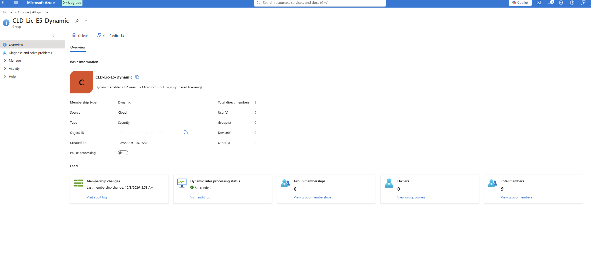
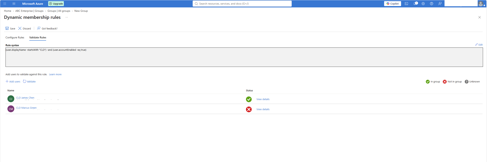
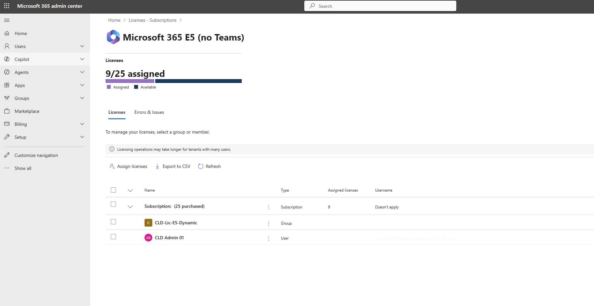
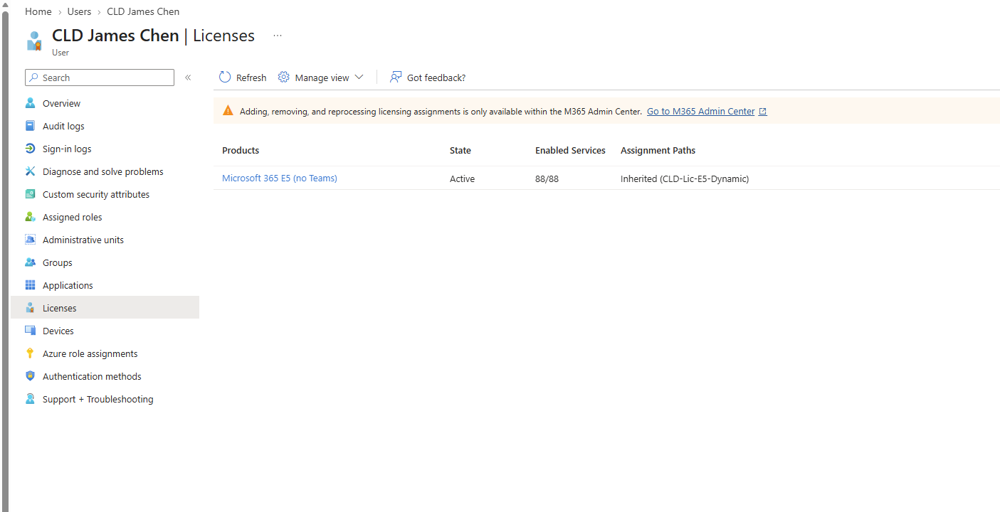
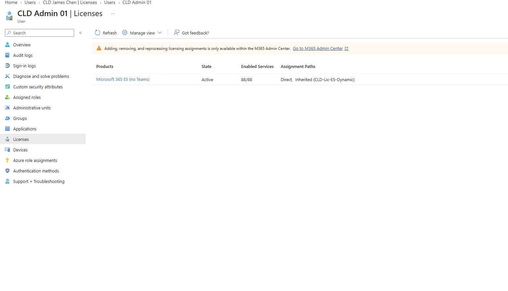
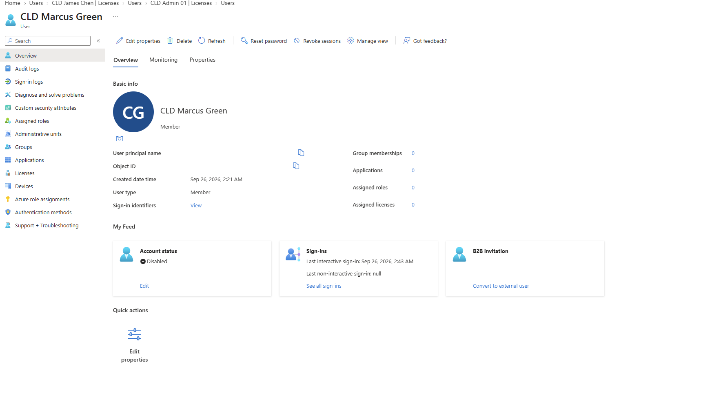

# Project 1: User Lifecycle — Joiner / Mover / Leaver

## Problem
Organizations need a repeatable, auditable way to onboard new hires, update people
who change roles or locations, and shut off access the moment someone leaves.
Manual, one-by-one changes are slow and error-prone, and a missed leaver is a
classic security gap.

## Environment
- **Tenant:** Microsoft Entra ID ("ABC Enterprise"), Entra ID Free, Security Defaults on
- **Admin tools:** Microsoft Entra admin center, Microsoft Graph PowerShell SDK
- **Accounts:** fictional cloud-only lab users with the `CLD-` prefix across IT, HR, Finance and Sales

## What I configured
1. **Joiner (bulk create):** prepared a CSV from the Entra bulk-create template and
   imported 8 new users through *Users > Bulk operations > Bulk create*. Portal bulk
   import is the fastest no-code option for HR-driven onboarding.
2. **Mover (bulk update with PowerShell):** the portal CSV import did not set City and
   Office, so I wrote a Graph PowerShell script that reads an HR CSV and runs
   `Update-MgUser` to set City, Country and UsageLocation for 7 users
   (New York, London, Hong Kong). Connected with delegated access and the
   least-privileged scope needed for writes: `User.ReadWrite.All`.
3. **Leaver (disable):** disabled the leaver account (Account enabled = No) rather than
   deleting it, so the account and its data stay available for review while
   access is cut immediately.

## Evidence

**1. Joiner input:** bulk-create CSV validated in the Entra admin center before import

**2. Joiner result:** new CLD- users created across IT, HR, Finance and Sales

**3. Leaver:** cld.user08 shown as disabled (Account enabled = No)

**4. Leaver negative test:** sign-in fails. The page says "account locked", but the sign-in log records **50057** (account disabled), not 50053 (smart lockout). The log code is the source of truth.

**5. Mover:** bulk location update with Microsoft Graph PowerShell (Update-MgUser from CSV), 7/7 users OK after fixing the empty State field

**6. Mover verified:** Get-MgUser confirms new City, Country and UsageLocation (US, GB, HK); leaver and admin accounts correctly untouched

## Verification
- **Positive test (joiner):** all new users appear in Entra with the correct
  display names and departments.
- **Positive test (mover):** `Get-MgUser` shows the updated City, Country and
  UsageLocation for all 7 users.
- **Negative test (leaver):** sign-in attempt as the disabled user fails, and the
  sign-in log records error **50057** (user account is disabled).
- **Scope check:** accounts not in the mover CSV (the leaver and the helpdesk
  admin) were not changed.

## What broke and how I fixed it
- **Block sign-in not applied on import:** the leaver still had access after the bulk
  import, so I disabled the account as a separate step and verified with a sign-in test.
- **Portal CSV didn't set City/Office:** moved the location update to Graph PowerShell,
  which turned into a reusable mover script.
- **Graph rejected an empty State value:** 4 users failed on the first run. I changed
  the script to skip empty fields and re-ran it: 7/7 OK.
- **Script blocked by execution policy (RemoteSigned):** the downloaded `.ps1` was
  flagged as coming from the internet. Fixed with `Unblock-File` after reviewing the
  script, instead of lowering the execution policy.

## In production I would...
- Drive joiners/movers/leavers from the HR system of record (or Entra inbound
  provisioning / Lifecycle Workflows) instead of manual CSVs.
- For leavers, also **revoke active sessions**, remove group memberships and
  licenses, and reassign owned resources, not just disable the account.
- Run scripts with an **app registration and certificate** (least-privileged
  application permissions) under change control, not an interactive admin session.
- Log every lifecycle action and review it in audit logs or a SIEM.
- Use **group-based licensing** and dynamic groups so access follows attributes
  automatically.

## Control mapping
| Control | Framework reference |
|---|---|
| Account creation, modification and disablement | NIST SP 800-53 **AC-2** (Account Management) |
| Identity management lifecycle | ISO/IEC 27001:2022 Annex A **5.16** |
| Provisioning and removal of access rights | ISO/IEC 27001:2022 Annex A **5.18** |
| Timely removal of access for leavers | SOX IT general controls (user access) |

## Interview talking point
"I automated the joiner-mover-leaver lifecycle in Microsoft Entra ID: bulk onboarding
from CSV, a Graph PowerShell script for location changes, and immediate disablement for
leavers, which I verified with a sign-in test returning error 50057. When Graph rejected
empty fields, I fixed the script and re-ran it to 7 out of 7 successes."

## Part 2: Automated licensing with a dynamic group

**Problem:** Manually assigning licenses to joiners and removing them from leavers is slow, error-prone, and wastes paid licenses on people who have left.

**What I configured:**
1. Created a dynamic security group `CLD-Lic-E5-Dynamic` with the rule
   `(user.displayName -startsWith "CLD") -and (user.accountEnabled -eq true)`
   so only enabled lab users are members.
2. Validated the rule before saving: an active user evaluated **in**, the disabled leaver evaluated **out**.
3. Assigned Microsoft 365 E5 to the group in the Microsoft 365 admin center (group license assignment is no longer editable from the Entra group page).

**Evidence**

**Dynamic group:** 9 members, rule processing succeeded (disabled leaver excluded)

**Rule validation:** active user in, disabled leaver out

**License assigned to the group:** 9/25 in use

**Member license inherited from the group**

**Direct + group assignment on one user consumes a single license**

**Disabled leaver:** no group membership, no license

**What I learned**
- A user with the same license assigned directly and through a group uses only **one** license.
- An inherited license can't be removed from the user directly; remove the user from the group (or, for a dynamic group, change the attribute the rule uses).
- Safe migration from direct to group licensing: assign the group first, then remove the direct assignment, so there is no service gap.
- Group licensing errors (missing usage location, not enough licenses, conflicting service plans) show under **Errors & Issues** in the Microsoft 365 admin center.

**Control mapping:** NIST SP 800-53 **AC-2(1)** (automated account management); ISO/IEC 27001:2022 Annex A **5.18** (access rights). Licenses are reclaimed automatically when access is removed.
