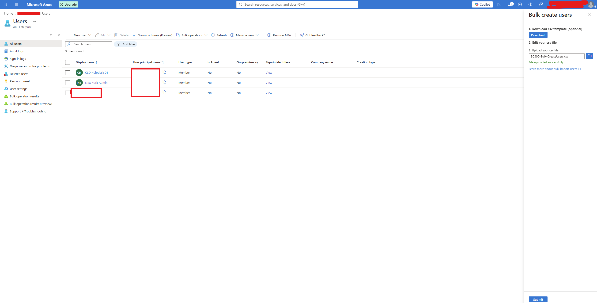
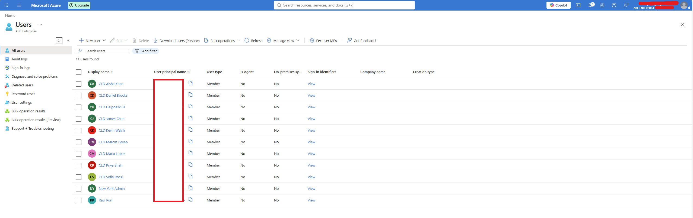
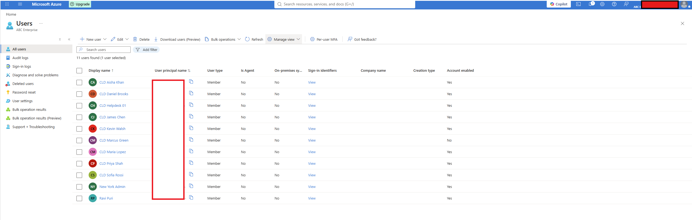
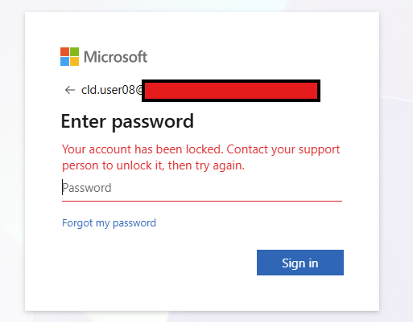
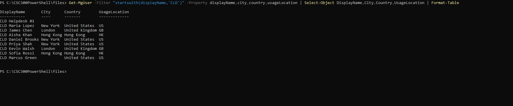

# Project 1: User Lifecycle (in progress)

## Evidence

**1. Joiner input:** bulk-create CSV validated in the Entra admin center before import

**2. Joiner result:** new CLD- users created across IT, HR, Finance and Sales

**3. Leaver:** cld.user08 shown as disabled (Account enabled = No)

**4. Leaver negative test:** disabled user cannot sign in (sign-in log error 50057)

**5. Mover:** bulk location update with Microsoft Graph PowerShell (Update-MgUser from CSV)

**6. Mover verified:** Get-MgUser confirms new City/Country (New York, London, Hong Kong)

